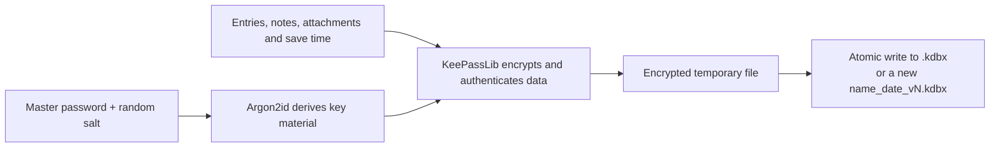
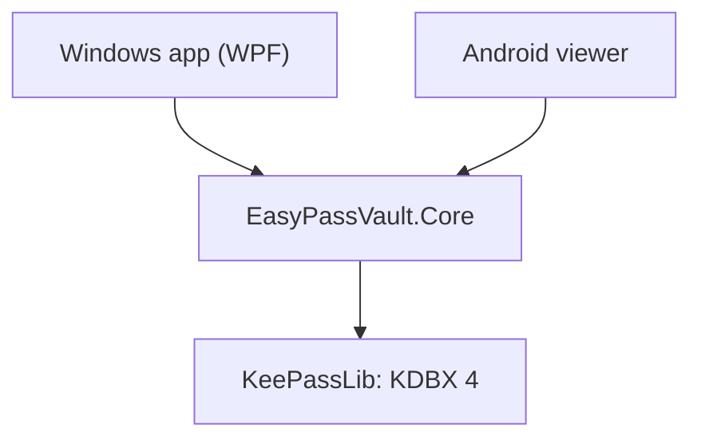
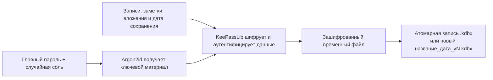
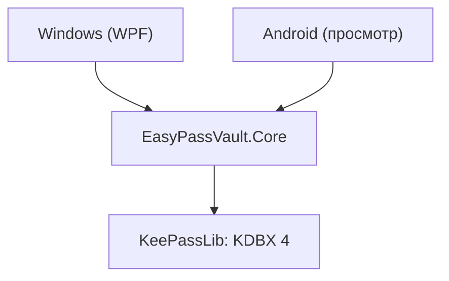

# easy-pass-vault

[English](#english) · [Русский](#русский)

## English

Offline password and text vault for Windows x64. [Download the latest release](https://github.com/dmakhazen/easy-pass-vault/releases/latest), extract `easy-pass-vault-win-x64.zip` and run `easy-pass-vault.exe`.

- Create or open a vault with a master password. Use **Save** or **Ctrl+S** to encrypt and write changes; the header shows how many edits are not saved yet. **Close vault** (**Ctrl+L**) closes the file and returns to the start screen. A forgotten master password cannot be recovered.
- The start screen remembers the last five opened vault files. The most recent one is shown in a card with the **Master password** field: type the password and press **Open** or **Enter**. Click another file under **Other recent files** to put it into the card. A file with a newer `_vN` version in the same folder is marked **a newer version exists**; a file that is gone is greyed out with **file not found** and a **Remove from list** button. **Open another file…** and **Create new vault** are below.
- **Quick search** (**Ctrl+K** or the magnifier button in the header) searches all folders, entries and files by title, username, website, text and attachment names — never by password or the contents of attachments — ignoring case. **↑ ↓** choose a result, **Enter** copies the password (opens a text file), **Ctrl+Enter** copies the username, **Tab** or a double click opens the item in the main window, **Esc** or a click outside closes the search. It works in the compact view too.
- **Search above the list** looks through **all folders** as soon as you type: the selected folder no longer limits it. The line under the filter shows **Found N · in all folders**, every found row shows its folder, and the query is marked yellow in titles. The open item shows its **folder path** above the title; each folder there is a button that clears the search and opens that folder. **Enter** or the arrow button next to the field goes to the **next match**: matches in the item's text are yellow, the current one is brighter and is scrolled to the middle of the editor; after the last match the next found item opens. The counter in the field (`2 / 5`) counts matches in the open text. **Esc** clears the search.
- Expand folders in the sidebar. **+ New folder** creates a folder inside the selected one. Select **All folders** to create one at the top level.
- Folder actions are in the folder menu: right-click a folder, or press **⋯** in the row of the selected folder. The menu offers **New subfolder**, **Rename** (**F2**) and **Delete folder** (**Del**). Only an empty folder without unsaved drafts can be deleted; otherwise the item is disabled and its tooltip says why.
- Copy in one click: **Copy** next to the username, password and website in the editor, and two small buttons on the selected list row and on the row under the mouse — copy username and copy password (green). An unsaved edit is copied as typed. Empty values cannot be copied. The clipboard is not cleared automatically. **Open** next to the website opens it in the default browser, only for a complete `http://` or `https://` address.
- **Password generator**: the **Generator** button with a die in the header opens it for the open entry or text file. It shows the password in large type, **Generate again**, a strength scale (length × log2 of the alphabet: below 50 bits weak, 50–80 medium, above 80 strong), length 8–64 (20 by default) and the sets **Uppercase A–Z**, **Lowercase a–z**, **Digits 0–9**, **Symbols** and **No look-alikes: O 0 l 1 I**. Every chosen set occurs at least once; characters come from the system cryptographic generator without modulo bias. The **Where** line says where the password will go, and the main button is named after it. In an entry it goes into the **Password** field (**Use as password**); when the caret was last in the entry's note, into the note at the caret (**Insert into note**). In a text file it goes into the text at the caret (**Insert into text**). A selection is replaced. It is an ordinary edit of the draft: **Ctrl+Z** undoes it, and you save to keep it. In the read-only JSON view the button is disabled. The length and the sets are remembered in `easy-pass-vault.window.json`; the password itself never is.
- **Headings and dividers** in text files and in the entry note: a line that starts with `# ` (hash and space) is shown as a green band, a line that is exactly `---` (spaces around allowed) as a thin line with three dots. The marks are hidden and appear only on the line with the caret. **# Heading** above the text adds or removes `# ` on the caret's line, **— Divider** inserts a `---` line after it, **?** explains the rules. There is no other markup: `##`, `**`, `-` and the rest stay plain text. The vault stores plain text with these marks, export and copying give it as typed, **Ctrl+Z** undoes the buttons like typing.
- **JSON text files**: a text file whose title ends with `.json` has a **Text / JSON** switch above its content. **JSON** shows the text indented, read-only, with search and **Copy all**, and without heading and divider marks; it never changes the stored text and never makes the vault unsaved. A file always opens in **Text**.
- **Attachments**: entries and text files can hold images, documents, archives and any other files. Drop files from Explorer onto the editor (the dashed zone **Drop images, documents or archives here**) or press **Choose files…**. A second file with the same name gets ` (2)`. The list under **Attachments · N** shows the extension, name, type, size and the date added; **View** opens PNG, JPG, GIF, BMP and WEBP pictures in a separate window straight from memory (WEBP needs the Windows codec); for `.json` it shows the JSON indented, and `.txt`, `.log`, `.csv`, `.xml`, `.md` as they are — read-only, in a monospaced font, with search (**Ctrl+F**, **Enter** for the next match) and **Copy all**. JSON that does not parse is shown as is with **The file is not valid JSON** and the error line; text that is not UTF-8 is shown with unreadable characters replaced and a warning. Above 20 MB the app asks first. Viewing never changes the attachment; **Save as…** writes a copy only where you choose, **×** removes the attachment after a question. A list row shows a paper clip with the number of attachments. Adding and removing are ordinary unsaved edits: save the vault to keep them, or undo them with the draft. Attachments are stored as standard KDBX 4 entry attachments inside the encrypted file; the app never writes a decrypted attachment to a temporary file and never opens it in another program. **Vault space: N of 512 MB** under the drop zone counts unsaved attachments too.
- Sorting: the **A→Z** button in the folders header switches folders between A→Z and Z→A on every level of the tree. The **Sort** button above the list orders entries and files by title (A→Z, Z→A) or by modification date (newest or oldest first). Titles are compared by the rules of the interface language, ignoring case. Sorting changes only the order on screen and never the vault file.
- **New file vN** writes the vault to a new file `{name}_{date}_v{number}.kdbx` next to the current one; the exact name, for example `personal_2026-11-05_v12.kdbx`, is shown in the button's tooltip and in the **⋯** menu. The number keeps growing across dates. The previous file is left unchanged and the new one becomes active. Like **Save**, the button is available only when there are unsaved changes. A new vault starts as `{name}_{date}_v1.kdbx`.
- **Versions of this vault…** in the **⋯** menu lists the files of the series in the vault's folder, newest first: number, file name, modification time and size on disk, with **open now** and **newest** marks, the name of the next file, and **Show in Explorer**. **Open** next to another version closes the current vault (asking about unsaved changes) and shows that file on the start screen for its master password.
- If you open an older version while a newer one exists, the app warns you. Creating a new file from it continues the series after the newest number without overwriting anything.
- The **⋯** menu in the header holds the rare actions: **Export text** writes all saved entries, including passwords, to an unencrypted TXT file in JSON format; attachments are not exported, only the name and size of each one; the interface language is chosen there too, also before a vault is opened. The header shows the last save time recorded inside the vault and the size of the vault file. Opening, saving and creating a new version file run in the background with **Opening…** or **Saving and encrypting…** and a spinner; the window takes no clicks until they finish.
- **Compact / Wide** in the header switches the window layout. Wide shows folders, the list and the editor side by side; drag the borders between them to resize. Compact is a narrow window: choose the folder from a drop-down list, and a selected item opens in place of the list with **Back to list**.
- The window size, position, area widths, view mode, the chosen sort order and the recent vault files are remembered in `easy-pass-vault.window.json` next to the EXE. Of a vault only its full path and the time it was last opened are stored there — no passwords, titles or other contents. The file can be deleted to reset the layout and the recent list.

### How encryption works



New vaults use AES-256 and HMAC authentication in KDBX 4. The app supports uncompressed KDBX 4.x with Argon2id. Attachments are inside the encryption like everything else.

**Size limits.** A vault file may be at most 512 MB, on opening and on saving: a larger file is rejected before it is read into memory or decrypted, and a save that would exceed the limit is refused without touching the file on disk. When added attachments would make the vault larger than about 100 MB, the app warns first: opening and every save take noticeable time, and every new version file takes the same space on disk. On a test machine a vault of random data opened in 0.5 s and saved in 1.8 s at 100 MB, and opened in 1 s and saved in 6.4 s at 300 MB. Compatibility with other clients has yet to be verified. The app has not undergone an independent security audit.

[Upstream KeePassLib.Standard repository](https://github.com/werdes/KeePassLib.Standard) · [KDBX 4 specification](https://keepass.info/help/kb/kdbx.html) · [Third-party notices](THIRD_PARTY_NOTICES.md)

### Build and test

Use the .NET SDK specified in `global.json`. Run these PowerShell commands from the project root:

```powershell
. ./scripts/Environment.ps1
& $dotnetExe restore src/EasyPassVault.App/EasyPassVault.App.csproj --configfile NuGet.Config
& $dotnetExe restore tests/EasyPassVault.Tests/EasyPassVault.Tests.csproj --configfile NuGet.Config
& $dotnetExe restore tests/EasyPassVault.UiTests/EasyPassVault.UiTests.csproj --configfile NuGet.Config
./scripts/Test.ps1
./scripts/Publish.ps1
```

To time opening and saving of large vaults made of random synthetic data (files go to `.artifacts/benchmark` and are deleted afterwards): `& $dotnetExe run --project tests/EasyPassVault.Tests/EasyPassVault.Tests.csproj -- --benchmark 100 300`.

The portable EXE is written to `.artifacts/portable/win-x64`. Pushes to `main` or `master` trigger a GitHub release build.

### Android viewer

`src/EasyPassVault.Android` is a read-only viewer of the same `.kdbx` files for Android 8 and newer. Copy the vault file to the phone, choose it in the app and enter the master password.



Both apps share the core and the encryption library; only the screens differ.

- It shows folders, entries and files, searches all folders, copies the username, password and website, and opens a website in the browser. It cannot change the vault: nothing is ever written to the file.
- The app asks for no permissions: no network and no storage access. It reads only the one file chosen in the system file picker and remembers its address, never the password.
- **Lock** closes the vault. **Settings** hold the interface language — English by default, Russian, Chinese, Hindi, Spanish, Arabic and French — and **Auto-lock**: off by default, or after 1 or 5 minutes in the background. Screenshots are blocked. Attachments are listed by name and size only.
- Build: `./scripts/Build-Apk.ps1` writes `.artifacts/android/easy-pass-vault-{version}.apk`. It needs the `android` workload in the .NET SDK, a JDK in `.tools/android/jdk` and the Android SDK in `.tools/android/sdk`. The signing key is created in `.tools/android/signing` on the first run; an update installs over the app only when it is signed with the same key. The GitHub release builds only the Windows app.

The version comes only from `<Version>` in `src/EasyPassVault.App/EasyPassVault.App.csproj`. A local build and the GitHub release of the same commit report the same version: the release tag is `v{Version}` (for example `v0.27.0`), and the window shows `0.27`. A push without a new `<Version>` fails instead of publishing a second release with the same number.

## Русский

Офлайн-хранилище паролей и текстовых заметок для Windows x64. Скачайте `easy-pass-vault-win-x64.zip` из [последнего релиза](https://github.com/dmakhazen/easy-pass-vault/releases/latest), распакуйте архив и запустите `easy-pass-vault.exe`.

- Создайте или откройте хранилище с главным паролем. Чтобы зашифровать и записать правки, нажмите **«Сохранить»** или **Ctrl+S**; в шапке видно, сколько правок ещё не сохранено. **«Закрыть хранилище»** (**Ctrl+L**) закрывает файл и возвращает на стартовый экран. Забытый главный пароль восстановить нельзя.
- Стартовый экран помнит пять последних открытых файлов хранилища. Самый свежий показан карточкой с полем **«Главный пароль»**: введите пароль и нажмите **«Открыть»** или **Enter**. Щелчок по файлу в списке **«Другие недавние»** переносит его в карточку. Если в той же папке есть более новая версия `_vN`, у файла стоит пометка **«есть версия новее»**; пропавший файл показан серым с пометкой **«файл не найден»** и кнопкой **«Убрать из списка»**. Ниже — **«Открыть другой файл…»** и **«Создать новое хранилище»**.
- **Быстрый поиск** (**Ctrl+K** или кнопка с лупой в шапке) ищет по всем папкам, записям и файлам — по названию, логину, сайту, тексту и именам вложений, без учёта регистра; по паролю и содержимому вложений не ищет. **↑ ↓** — выбор, **Enter** копирует пароль (у текстового файла — открывает его), **Ctrl+Enter** копирует логин, **Tab** или двойной щелчок открывает элемент в главном окне, **Esc** или щелчок мимо панели закрывает поиск. Работает и в компактном виде.
- **Поиск над списком** ищет по **всем папкам**, как только в поле есть текст: выбранная папка его больше не ограничивает. Под фильтром — строка **«Найдено N · во всех папках»**, у каждой найденной строки показана её папка, а запрос в названиях отмечен жёлтым. У открытого элемента над названием — **путь к папке**; каждая папка в нём — кнопка: она сбрасывает поиск и открывает эту папку. **Enter** или кнопка со стрелкой рядом с полем ведёт к **следующему совпадению**: совпадения в тексте элемента жёлтые, текущее ярче и прокручивается в середину редактора; после последнего открывается следующий найденный элемент. Счётчик в поле (`2 / 5`) считает совпадения в открытом тексте. **Esc** очищает поиск.
- Раскрывайте ветки дерева слева. **«+ Новая папка»** создаёт вложенную папку внутри выбранной. Для верхнего уровня выберите **«Все папки»**.
- Действия с папкой собраны в меню папки: щёлкните по папке правой кнопкой или нажмите **«⋯»** в строке выбранной папки. В меню — **«Новая вложенная папка»**, **«Переименовать»** (**F2**) и **«Удалить папку»** (**Del**). Удалить можно только пустую папку без несохранённых черновиков; иначе пункт неактивен, а подсказка объясняет причину.
- Копирование в один клик: кнопка **«Копировать»** справа от логина, пароля и сайта в редакторе, и две маленькие кнопки в выбранной строке списка и в строке под курсором — скопировать логин и скопировать пароль (зелёная). Несохранённая правка копируется как набрана. Пустое значение скопировать нельзя. Буфер обмена сам не очищается. **«Открыть»** рядом с сайтом открывает адрес в браузере по умолчанию — только полный адрес с `http://` или `https://`.
- **Генератор паролей**: кнопка **«Генератор»** с кубиком в шапке, для открытой записи или текстового файла. В окне — готовый пароль крупным шрифтом, **«Сгенерировать заново»**, шкала надёжности (длина × log2 размера алфавита: ниже 50 бит — слабая, 50–80 — средняя, выше — высокая), длина 8–64 (по умолчанию 20) и наборы **«Заглавные A–Z»**, **«Строчные a–z»**, **«Цифры 0–9»**, **«Символы»** и **«Без похожих: O 0 l 1 I»**. Каждый выбранный набор встречается хотя бы раз; символы берутся из системного криптографического генератора без смещения по модулю. Строка **«Куда»** заранее говорит, куда попадёт пароль, и главная кнопка названа так же. В записи пароль идёт в поле **«Пароль»** (**«Подставить в пароль»**); если курсор последним стоял в заметке записи — в заметку на место курсора (**«Вставить в заметку»**). В текстовом файле — в текст на место курсора (**«Вставить в текст»**). Выделенный текст заменяется. Это обычная правка черновика: **Ctrl+Z** её отменяет, а чтобы она осталась, нужно сохранить. В виде «JSON», который только для чтения, кнопка неактивна. Длина и наборы запоминаются в `easy-pass-vault.window.json`, сам пароль — никогда.
- **Заголовки и разделители** в текстовых файлах и в заметке записи: строка, которая начинается с `# ` (решётка и пробел), показывается зелёной плашкой, строка ровно из `---` (пробелы по краям допустимы) — тонкой линией с тремя точками. Значки скрыты и видны только в строке с курсором. Над текстом: **«# Заголовок»** ставит или снимает `# ` у строки с курсором, **«— Разделитель»** вставляет строку `---` после неё, **«?»** — справка. Другой разметки нет: `##`, `**`, `-` и прочее остаются обычным текстом. В хранилище лежит обычный текст с этими знаками, экспорт и копирование отдают его как набран, **Ctrl+Z** отменяет действие кнопок, как ввод.
- **JSON в текстовых файлах**: у текстового файла, название которого оканчивается на `.json`, над содержимым есть переключатель **«Текст / JSON»**. **«JSON»** показывает текст с отступами, только для чтения, с поиском и **«Копировать всё»**, без заголовков и разделителей; сохранённый текст он не меняет и хранилище «несохранённым» не делает. Файл всегда открывается в виде «Текст».
- **Вложения**: к записям и текстовым файлам можно прикладывать картинки, документы, архивы и любые другие файлы. Перетащите файлы из Проводника на редактор (зона с пунктирной рамкой **«Перетащите сюда картинки, документы или архивы»**) или нажмите **«Выбрать файлы…»**. Второй файл с тем же именем получает суффикс « (2)». В списке **«Вложения · N»** — расширение, имя, тип, размер и дата добавления; **«Просмотр»** открывает картинки PNG, JPG, GIF, BMP и WEBP в отдельном окне прямо из памяти (для WEBP нужен кодек Windows); `.json` — отформатированным с отступами, `.txt`, `.log`, `.csv`, `.xml`, `.md` — как есть: только чтение, моноширинный шрифт, поиск (**Ctrl+F**, **Enter** — следующее совпадение) и **«Копировать всё»**. Неразбираемый JSON показывается как есть со строкой «Файл не является корректным JSON» и номером строки ошибки, текст не в UTF-8 — с заменой нечитаемых символов и предупреждением. Для вложений больше 20 МБ программа сначала спрашивает. Просмотр вложение не меняет; **«Сохранить как…»** записывает копию только туда, куда вы укажете, **«×»** удаляет вложение после вопроса. В строке списка — скрепка с числом вложений. Добавление и удаление — обычные несохранённые правки: чтобы они остались, сохраните хранилище; отменяются они вместе с черновиком. Вложения хранятся штатными вложениями записей KDBX 4 внутри зашифрованного файла; расшифрованное вложение программа не пишет во временные файлы и не открывает в других программах. Шкала **«Место в хранилище: N из 512 МБ»** под зоной перетаскивания учитывает и несохранённые вложения.
- Сортировка: кнопка **«А→Я»** в заголовке «Папки» переключает порядок папок А→Я и Я→А на каждом уровне дерева. Кнопка **«Сортировка»** над списком упорядочивает записи и файлы по названию (А→Я, Я→А) или по дате изменения (сначала новые или сначала старые). Названия сравниваются по правилам языка интерфейса, без учёта регистра. Сортировка меняет только порядок на экране и ничего не пишет в файл хранилища.
- **«Новый файл vN»** записывает хранилище в новый файл `{название}_{дата}_v{номер}.kdbx` рядом с текущим; точное имя, например `personal_2026-11-05_v12.kdbx`, видно во всплывающей подсказке кнопки и в меню **«⋯»**. Номер сквозной и не сбрасывается со сменой даты. Прежний файл не меняется, новый становится открытым. Как и «Сохранить», кнопка активна только при несохранённых изменениях. Новое хранилище начинается с `{название}_{дата}_v1.kdbx`.
- Пункт **«Версии этого хранилища…»** в меню **«⋯»** показывает файлы серии из папки хранилища, самый новый сверху: номер, имя файла, время изменения и размер на диске, пометки **«открыта»** и **«самая новая»**, имя следующего файла и кнопку **«Показать в проводнике»**. **«Открыть»** у другой версии закрывает текущее хранилище (с вопросом о несохранённых правках) и показывает выбранный файл на стартовом экране — для ввода главного пароля.
- Если открыть старую версию, когда есть более новая, программа предупредит. Новый файл из неё продолжит нумерацию после самого большого номера и ничего не перезапишет.
- В меню **«⋯»** в шапке собраны редкие действия: **«Экспорт в текст»** записывает все сохранённые записи, включая пароли, в незашифрованный TXT в формате JSON; вложения не выгружаются — только имя и размер каждого; там же выбирается язык интерфейса — в том числе до открытия хранилища. В шапке видны дата последнего сохранения из самого хранилища и размер файла хранилища. Открытие, сохранение и создание нового файла версии идут в фоне с индикатором **«Открываю…»** или **«Сохраняю и шифрую…»**; пока они не закончатся, окно не принимает щелчки.
- Переключатель **«Компактно / Широко»** в шапке меняет вид окна. «Широко» — папки, список и редактор рядом; границы между ними перетаскиваются мышью. «Компактно» — узкое окно: папка выбирается из выпадающего списка, а выбранная запись открывается на месте списка с кнопкой **«Назад к списку»**.
- Размер и положение окна, ширина областей, выбранный вид, выбранная сортировка и недавние хранилища запоминаются в файле `easy-pass-vault.window.json` рядом с EXE. О хранилище там только полный путь и время последнего открытия — ни паролей, ни названий записей, ни другого содержимого. Чтобы сбросить вид и список недавних, файл можно удалить.

### Как работает шифрование



Новые хранилища используют AES-256 и HMAC в формате KDBX 4. Поддерживается KDBX 4.x с Argon2id без сжатия. Вложения, как и всё остальное, находятся внутри шифрования.

**Ограничения размера.** Файл хранилища — не больше 512 МБ, и при открытии, и при сохранении: файл больше отклоняется до чтения в память и расшифровки, а сохранение, после которого файл превысил бы предел, отменяется без изменения файла на диске. Если после добавления вложений хранилище станет больше примерно 100 МБ, программа сначала предупредит: открытие и каждое сохранение будут занимать заметное время, а каждая новая версия файла займёт столько же места на диске. На тестовом компьютере хранилище из случайных данных открывалось за 0,5 с и сохранялось за 1,8 с при 100 МБ, открывалось за 1 с и сохранялось за 6,4 с при 300 МБ. Совместимость с другими клиентами пока не проверена. Приложение не проходило независимый аудит безопасности.

[Исходный репозиторий KeePassLib.Standard](https://github.com/werdes/KeePassLib.Standard) · [Спецификация KDBX 4](https://keepass.info/help/kb/kdbx.html) · [Сторонние компоненты и лицензии](THIRD_PARTY_NOTICES.md)

Для сборки и тестов используйте команды из [английского раздела](#build-and-test). Готовый EXE появится в `.artifacts/portable/win-x64`. Push в `main` или `master` запускает сборку релиза.

### Просмотр на Android

`src/EasyPassVault.Android` — приложение для Android 8 и новее, которое открывает те же файлы `.kdbx` только для просмотра. Скопируйте файл хранилища на телефон, выберите его в приложении и введите главный пароль.



Ядро и библиотека шифрования у обоих приложений общие, отличаются только экраны.

- Показывает папки, записи и файлы, ищет по всем папкам, копирует логин, пароль и сайт, открывает сайт в браузере. Менять хранилище не умеет: в файл ничего не записывается.
- Разрешений приложение не запрашивает: ни сети, ни доступа к памяти телефона. Читает только один файл, выбранный в системном окне, и запоминает его адрес — пароль не запоминает.
- **«Заблокировать»** закрывает хранилище. В **«Настройках»** — язык интерфейса (по умолчанию английский; ещё русский, китайский, хинди, испанский, арабский и французский) и **«Автоблокировка»**: по умолчанию выключена, либо через 1 или 5 минут после сворачивания. Снимки экрана запрещены. Вложения показаны только именем и размером.
- Сборка: `./scripts/Build-Apk.ps1` кладёт `.artifacts/android/easy-pass-vault-{версия}.apk`. Нужны workload `android` в .NET SDK, JDK в `.tools/android/jdk` и Android SDK в `.tools/android/sdk`. Ключ подписи создаётся в `.tools/android/signing` при первом запуске; обновление ставится поверх приложения, только если подписано тем же ключом. Релиз на GitHub собирает только Windows-версию.

Версия задаётся только в `<Version>` файла `src/EasyPassVault.App/EasyPassVault.App.csproj`. Локальная сборка и релиз на GitHub из одного коммита показывают одну и ту же версию: тег релиза `v{Version}` (например, `v0.27.0`), в окне программы — `0.27`. Push без новой `<Version>` завершится ошибкой, а не выпустит второй релиз с тем же номером.
