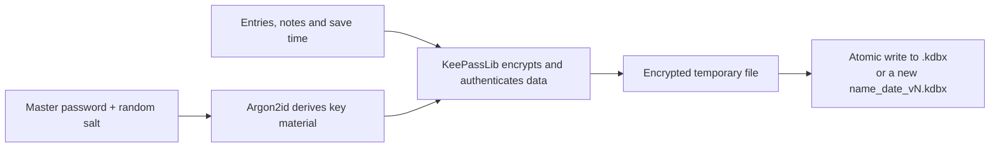
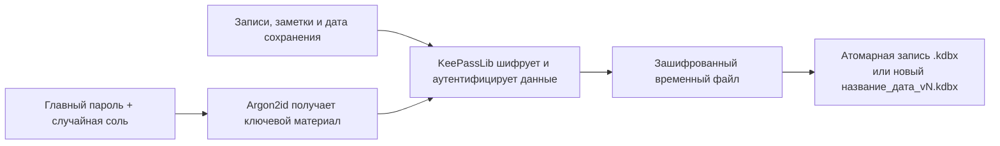

# easy-pass-vault

[English](#english) · [Русский](#русский)

## English

Offline password and text vault for Windows x64. [Download the latest release](https://github.com/dmakhazen/easy-pass-vault/releases/latest), extract `easy-pass-vault-win-x64.zip` and run `easy-pass-vault.exe`.

- Create or open a vault with a master password. Use **Save and encrypt** or **Ctrl+S** to write changes. A forgotten master password cannot be recovered.
- Expand folders in the sidebar. **New folder** creates a folder inside the selected one. Select **All folders** to create one at the top level.
- **Create new file and encrypt to …** writes the vault to a new file `{name}_{date}_v{number}.kdbx` next to the current one; the button shows the exact name, for example `personal_2026-11-05_v12.kdbx`. The number keeps growing across dates. The previous file is left unchanged and the new one becomes active. Like **Save and encrypt**, the button is available only when there are unsaved changes. A new vault starts as `{name}_{date}_v1.kdbx`.
- If you open an older version while a newer one exists, the app warns you. Creating a new file from it continues the series after the newest number without overwriting anything.
- **Export text** writes all saved entries, including passwords, to an unencrypted TXT file in JSON format. The header shows the last save time recorded inside the vault.

### How encryption works



New vaults use AES-256 and HMAC authentication in KDBX 4. The app supports uncompressed KDBX 4.x with Argon2id, up to 32 MB. Compatibility with other clients has yet to be verified. The app has not undergone an independent security audit.

[Upstream KeePassLib.Standard repository](https://github.com/werdes/KeePassLib.Standard) · [KDBX 4 specification](https://keepass.info/help/kb/kdbx.html) · [Third-party notices](THIRD_PARTY_NOTICES.md)

### Build and test

Use the .NET SDK specified in `global.json`. Run these PowerShell commands from the project root:

```powershell
. ./scripts/Environment.ps1
& $dotnetExe restore src/EasyPassVault.App/EasyPassVault.App.csproj --configfile NuGet.Config
& $dotnetExe restore tests/EasyPassVault.Tests/EasyPassVault.Tests.csproj --configfile NuGet.Config
& $dotnetExe restore tests/EasyPassVault.UiTests/EasyPassVault.UiTests.csproj --configfile NuGet.Config
./scripts/Test.ps1
./scripts/Publish.ps1
```

The portable EXE is written to `.artifacts/portable/win-x64`. Pushes to `main` or `master` trigger a GitHub release build.

The version comes only from `<Version>` in `src/EasyPassVault.App/EasyPassVault.App.csproj`. A local build and the GitHub release of the same commit report the same version: the release tag is `v{Version}` (for example `v0.21.0`), and the window shows `0.21`. A push without a new `<Version>` fails instead of publishing a second release with the same number.

## Русский

Офлайн-хранилище паролей и текстовых заметок для Windows x64. Скачайте `easy-pass-vault-win-x64.zip` из [последнего релиза](https://github.com/dmakhazen/easy-pass-vault/releases/latest), распакуйте архив и запустите `easy-pass-vault.exe`.

- Создайте или откройте хранилище с главным паролем. Для записи правок нажмите **«Сохранить и зашифровать»** или **Ctrl+S**. Забытый главный пароль восстановить нельзя.
- Раскрывайте ветки дерева слева. **«Новая папка»** создаёт вложенную папку внутри выбранной. Для верхнего уровня выберите **«Все папки»**.
- **«Создать новый файл и зашифровать в …»** записывает хранилище в новый файл `{название}_{дата}_v{номер}.kdbx` рядом с текущим; точное имя видно на кнопке, например `personal_2026-11-05_v12.kdbx`. Номер сквозной и не сбрасывается со сменой даты. Прежний файл не меняется, новый становится открытым. Как и «Сохранить и зашифровать», кнопка активна только при несохранённых изменениях. Новое хранилище начинается с `{название}_{дата}_v1.kdbx`.
- Если открыть старую версию, когда есть более новая, программа предупредит. Новый файл из неё продолжит нумерацию после самого большого номера и ничего не перезапишет.
- **«Экспорт в текст»** записывает все сохранённые записи, включая пароли, в незашифрованный TXT в формате JSON. В шапке видна дата последнего сохранения из самого хранилища.

### Как работает шифрование



Новые хранилища используют AES-256 и HMAC в формате KDBX 4. Поддерживается KDBX 4.x с Argon2id без сжатия, до 32 МБ. Совместимость с другими клиентами пока не проверена. Приложение не проходило независимый аудит безопасности.

[Исходный репозиторий KeePassLib.Standard](https://github.com/werdes/KeePassLib.Standard) · [Спецификация KDBX 4](https://keepass.info/help/kb/kdbx.html) · [Сторонние компоненты и лицензии](THIRD_PARTY_NOTICES.md)

Для сборки и тестов используйте команды из [английского раздела](#build-and-test). Готовый EXE появится в `.artifacts/portable/win-x64`. Push в `main` или `master` запускает сборку релиза.

Версия задаётся только в `<Version>` файла `src/EasyPassVault.App/EasyPassVault.App.csproj`. Локальная сборка и релиз на GitHub из одного коммита показывают одну и ту же версию: тег релиза `v{Version}` (например, `v0.21.0`), в окне программы — `0.21`. Push без новой `<Version>` завершится ошибкой, а не выпустит второй релиз с тем же номером.
