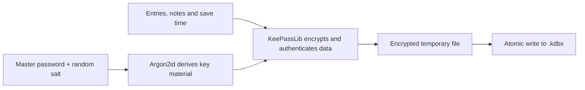
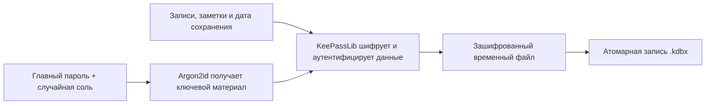

# easy-pass-vault

[English](#english) · [Русский](#русский)

## English

Offline password and text vault for Windows x64. [Download the latest release](https://github.com/dmakhazen/easy-pass-vault/releases/latest), extract `easy-pass-vault-win-x64.zip` and run `easy-pass-vault.exe`.

- Create or open a vault with a master password. Use **Save and encrypt** or **Ctrl+S** to write changes. A forgotten master password cannot be recovered.
- Expand folders in the sidebar. **New folder** creates a folder inside the selected one. Select **All folders** to create one at the top level.
- **Save dated version** opens a save dialog with a suggested name such as `personal-2026-11-03.kdbx`. Choose the folder and name. The saved file becomes active. The app protects other files with the same name from being overwritten.
- **Export text** writes all saved entries, including passwords, to an unencrypted TXT file in JSON format. The header shows the last save time recorded inside the vault.

### How encryption works



New vaults use AES-256 and HMAC authentication in KDBX 4. The app supports uncompressed KDBX 4.x with Argon2id, up to 32 MB. Compatibility with other clients has yet to be verified. The app has not undergone an independent security audit.

[Upstream KeePassLib.Standard repository](https://github.com/werdes/KeePassLib.Standard) · [KDBX 4 specification](https://keepass.info/help/kb/kdbx.html) · [Third-party notices](THIRD_PARTY_NOTICES.md)

### Build and test

Use the .NET SDK specified in `global.json`. Run these PowerShell commands from the project root:

```powershell
. ./scripts/Environment.ps1
& $dotnetExe restore src/EasyPassVault.App/EasyPassVault.App.csproj --configfile NuGet.Config
& $dotnetExe restore tests/EasyPassVault.Tests/EasyPassVault.Tests.csproj --configfile NuGet.Config
& $dotnetExe restore tests/EasyPassVault.UiTests/EasyPassVault.UiTests.csproj --configfile NuGet.Config
./scripts/Test.ps1
./scripts/Publish.ps1
```

The portable EXE is written to `.artifacts/portable/win-x64`. Pushes to `main` or `master` trigger a GitHub release build.

## Русский

Офлайн-хранилище паролей и текстовых заметок для Windows x64. Скачайте `easy-pass-vault-win-x64.zip` из [последнего релиза](https://github.com/dmakhazen/easy-pass-vault/releases/latest), распакуйте архив и запустите `easy-pass-vault.exe`.

- Создайте или откройте хранилище с главным паролем. Для записи правок нажмите **«Сохранить и зашифровать»** или **Ctrl+S**. Забытый главный пароль восстановить нельзя.
- Раскрывайте ветки дерева слева. **«Новая папка»** создаёт вложенную папку внутри выбранной. Для верхнего уровня выберите **«Все папки»**.
- **«Сохранить с датой»** открывает окно выбора папки и имени, предлагая имя вроде `personal-2026-11-03.kdbx`. Сохранённая версия становится активной. Другие файлы с тем же именем защищены от перезаписи.
- **«Экспорт в текст»** записывает все сохранённые записи, включая пароли, в незашифрованный TXT в формате JSON. В шапке видна дата последнего сохранения из самого хранилища.

### Как работает шифрование



Новые хранилища используют AES-256 и HMAC в формате KDBX 4. Поддерживается KDBX 4.x с Argon2id без сжатия, до 32 МБ. Совместимость с другими клиентами пока не проверена. Приложение не проходило независимый аудит безопасности.

[Исходный репозиторий KeePassLib.Standard](https://github.com/werdes/KeePassLib.Standard) · [Спецификация KDBX 4](https://keepass.info/help/kb/kdbx.html) · [Сторонние компоненты и лицензии](THIRD_PARTY_NOTICES.md)

Для сборки и тестов используйте команды из [английского раздела](#build-and-test). Готовый EXE появится в `.artifacts/portable/win-x64`. Push в `main` или `master` запускает сборку релиза.
